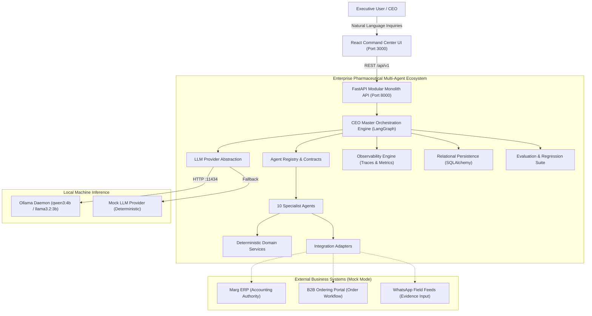
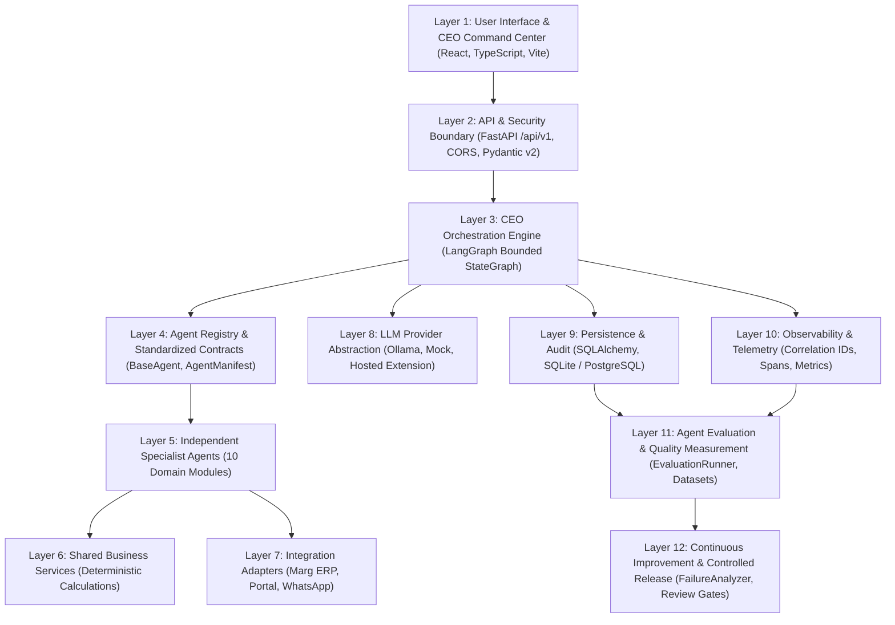
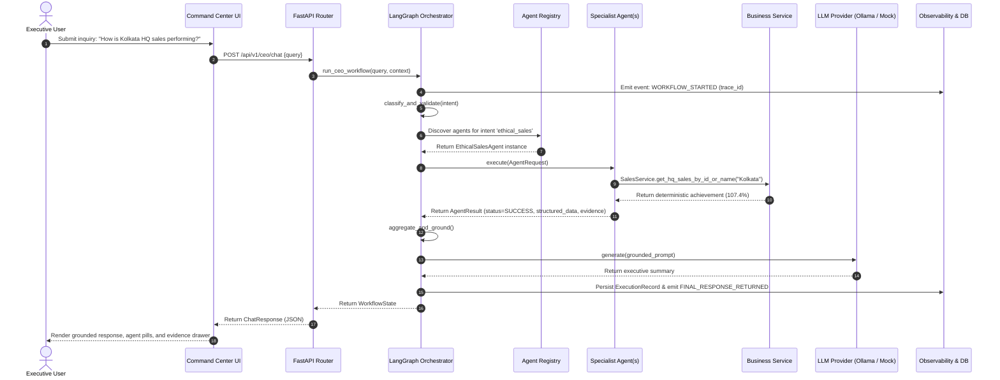
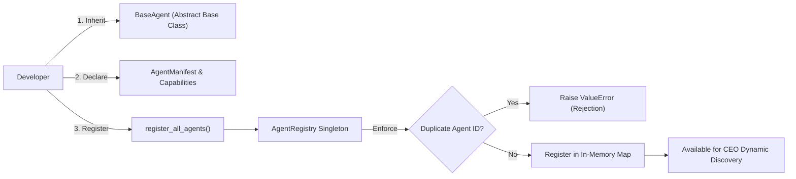
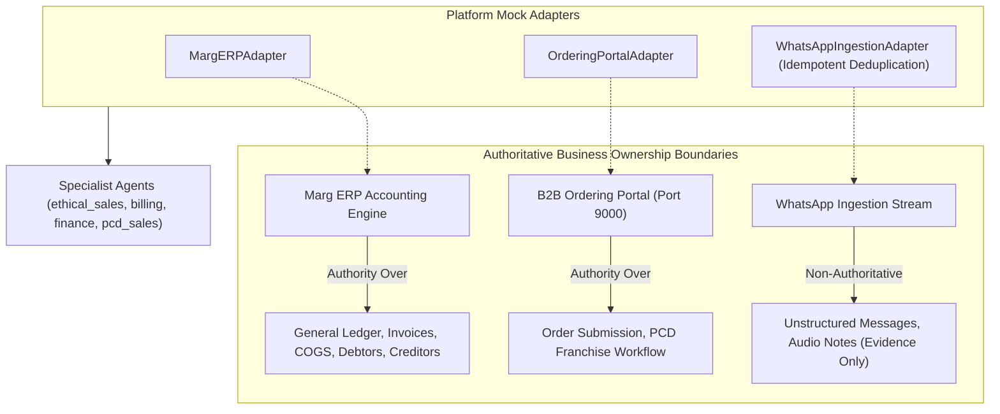
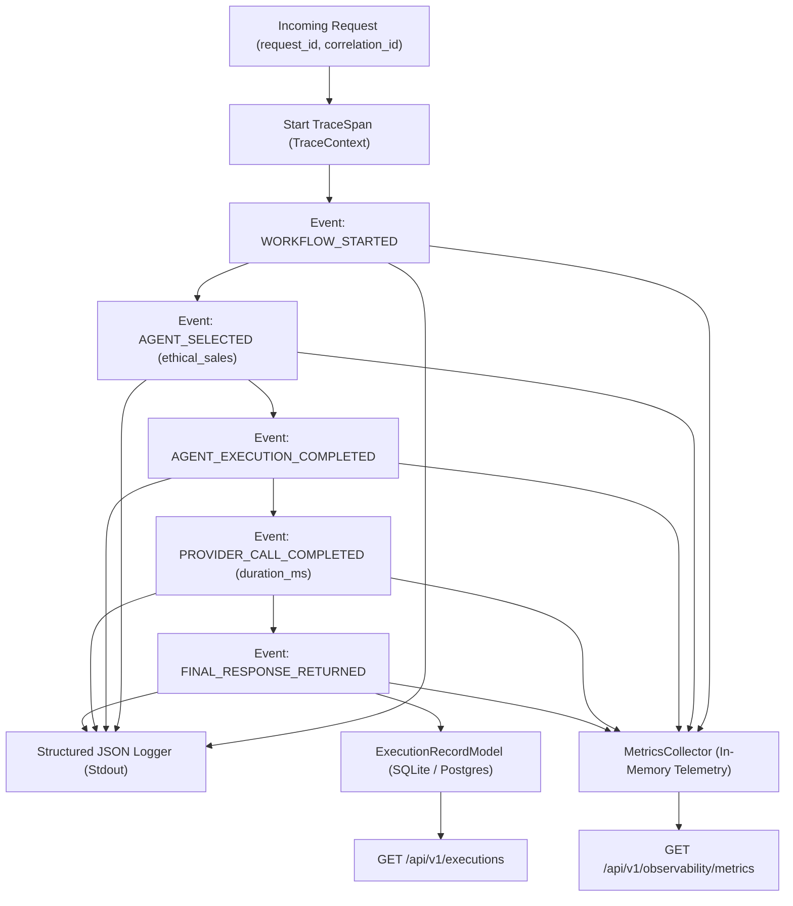
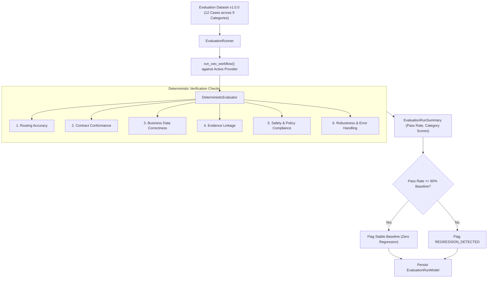
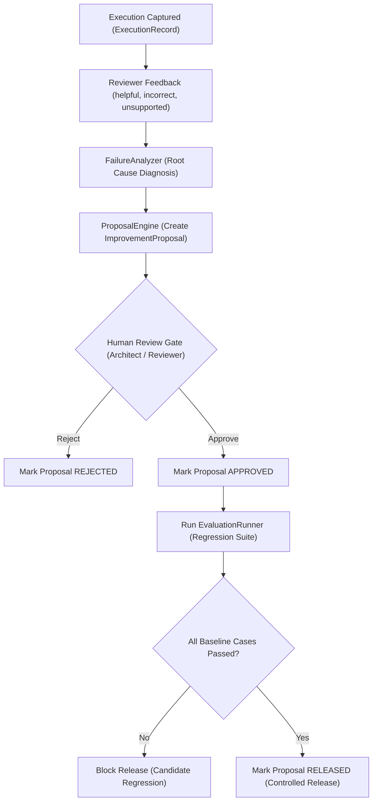
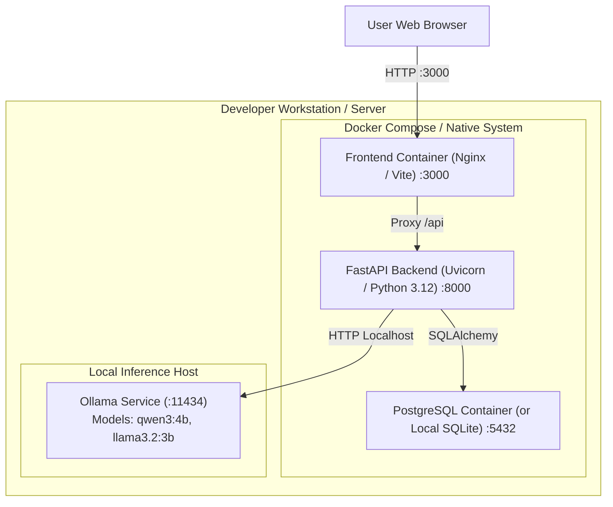

# Enterprise Pharmaceutical Agentic AI Ecosystem — Architecture Specification

## 1. Executive Summary

This document specifies the software architecture for the **Enterprise Pharmaceutical Agentic AI Ecosystem** designed for **Bengal Remedies**. The platform provides an executive conversational interface for the Chief Executive Officer (CEO), bounded multi-agent orchestration, specialist agents across 10 functional domains, deterministic accounting services, mock enterprise integrations, zero-cost local LLM inference, structured observability, and an automated evaluation and continuous-improvement lifecycle.

---

## 2. System Context Diagram (C4 Level 1)

---

## 3. High-Level Layered Architecture (12 Logical Layers)

The platform is structured into 12 distinct logical layers within a modular monolith. Observability and evaluation are native first-class citizens, not peripheral utilities.

---

## 4. CEO Orchestration Sequence Diagram

---

## 5. Agent Registration and Onboarding Architecture

New specialist agents are introduced without modifying the CEO Master Agent or existing agents.

---

## 6. Integration Adapter Boundary & Data Ownership

---

## 7. Observability Event and Trace Flow

---

## 8. Agent Evaluation Pipeline

---

## 9. Continuous Improvement Lifecycle (Controlled Governance)

---

## 10. Deployment Architecture (Local & Docker)

---

## 11. Data Ownership and Persistence Boundaries

| Entity | Primary Authority | Persistence Model | Storage Location | Notes |
| :--- | :--- | :--- | :--- | :--- |
| Invoices & COGS | Marg ERP | Synthetic Fixture | Memory / ERP Ledger | Deterministic calculation source |
| Debtors & Aging | Marg ERP | Synthetic Fixture | Memory / AR Register | Exact 0-30, 31-60, 61-90, >90 day buckets |
| Franchise Orders | B2B Ordering Portal | Synthetic Fixture | Memory / Portal DB | PCD order intake authority |
| WhatsApp Messages | Field Groups | Synthetic Ingest | Memory Fixture | Evidence only; non-authoritative |
| Execution Records | AI Platform | `ExecutionRecordModel` | SQLite / PostgreSQL | Persisted telemetry with correlation IDs |
| Feedback Records | Reviewer Workflow | `FeedbackRecordModel` | SQLite / PostgreSQL | Human-in-the-loop audit |
| Evaluation Runs | Quality Harness | `EvaluationRunModel` | SQLite / PostgreSQL | Versioned test run results |
| Improvement Proposals | Release Governance| `ImprovementProposalModel`| SQLite / PostgreSQL | Human-reviewed improvement items |
